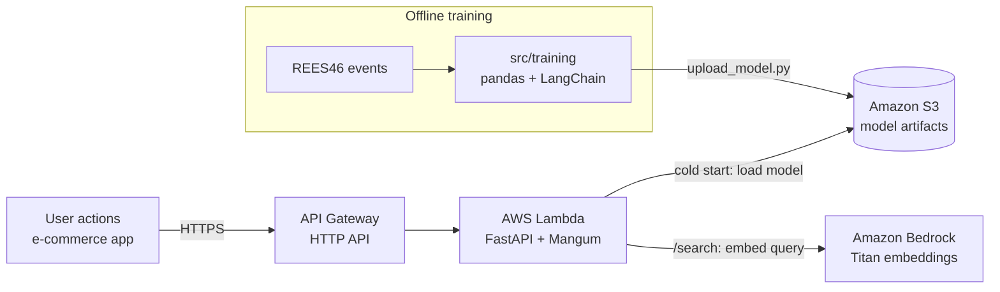

# Real-Time Recommendation System

**Problem:** E-commerce platforms lose sales because their recommendations do not adapt to what users are doing *right now*.

**Solution:** A real-time recommendation API that updates product suggestions on every user interaction (view, add-to-cart, purchase) within the same session. It is built with Python 3, FastAPI, AWS Lambda, S3 and LangChain.

**Impact (design targets):** Sized for **1M daily users** (~2,000 req/s at peak) with **p99 latency < 200 ms**. Business impact is estimated offline by replaying real e-commerce sessions and comparing against a popularity baseline. Measured results are published in [Target metrics](#target-metrics) as each phase is completed.

**Tech stack:** Python 3.12 · FastAPI · AWS Lambda · Amazon S3 · API Gateway · LangChain · Amazon Bedrock · Terraform · Docker · k6

**New technologies to learn:** Python 3, FastAPI, AWS Lambda, LangChain, Terraform

> 🚧 Work in progress. Step-by-step plan: [`docs/PLAN.md`](docs/PLAN.md).

## Phased plan

| Phase | Scope | Plan days | Status |
|---|---|---|---|
| **1. Design & data** | Architecture, dataset (REES46), baseline recommender artifacts | Days 0–2 | 🟡 In progress |
| **2. Backend: FastAPI + AWS Lambda** | Session-aware API, S3 model loading, Lambda packaging | Days 3–5 | ⬜ |
| **3. LangChain integration** | Natural-language product search with embeddings | Day 6 | ⬜ |
| **4. Deploy, latency & load testing** | CI, Terraform deployment, k6 load tests, offline uplift estimate | Days 7–8 | ⬜ |

## Overview

The system receives user interaction events in real time, keeps a short-lived view of the current shopping session and answers with personalized product recommendations. It is exposed as a REST API built with FastAPI. The same code runs locally with uvicorn and on AWS Lambda behind API Gateway.

Recommendations come from a fast, explainable model (session-weighted item co-occurrence with a popularity fallback) that is pre-computed offline and loaded from S3 at cold start. LangChain is used where language models add value without hurting latency: semantic product search over embeddings. The LLM stays out of the hot path of every recommendation request.

The whole environment runs locally for $0 using emulators: moto for S3, the AWS Lambda Runtime Interface Emulator and Ollama for embeddings. A single Terraform apply deploys it to real AWS.

## Architecture



- **User actions**: events (`view`, `cart`, `purchase`) sent by the e-commerce front end.
- **API Gateway (HTTP API)**: public HTTPS endpoint; forwards every route to the Lambda function.
- **AWS Lambda (FastAPI + Mangum)**: validates requests, updates the session and ranks candidates. Mangum adapts API Gateway events to FastAPI.
- **Amazon S3**: stores model artifacts (popular items, item co-occurrence, search index) and the Lambda package.
- **LangChain + Bedrock**: embeddings for natural-language product search.
- **Offline training** (`src/training`): builds the artifacts from historical events.

Locally, the same boxes are replaced by moto (S3), the Lambda Runtime Interface Emulator (Lambda) and Ollama (Bedrock), all started with `docker compose`.

## Repository structure

```
.
├── .devcontainer/            # Optional VS Code Dev Container (Python 3.12, uv, AWS CLI, Terraform)
├── docker-compose.yml        # Local cloud simulation: S3 (moto), Ollama, Lambda emulator, k6
├── loadtest/
│   └── k6.js                 # Load test (smoke and 1,000-VU profiles)
├── src/
│   ├── app/                  # FastAPI application (domain + infrastructure)
│   ├── lambda/
│   │   └── handler.py        # AWS Lambda entry point (Mangum)
│   ├── training/             # Offline jobs that build the model artifacts
│   ├── scripts/              # build_lambda, invoke_lambda, upload_model, local-env.ps1
│   └── infra/
│       └── terraform/        # API Gateway, Lambda, S3, IAM, CloudWatch
├── tests/                    # pytest unit and integration tests
└── docs/
    ├── PLAN.md               # Day-by-day implementation plan
    └── adr/                  # Architecture Decision Records
```

## Local environment (cloud simulation)

Prerequisites: [uv](https://docs.astral.sh/uv/) and Docker Desktop. **No AWS account is needed.**

```powershell
# 1. Install dependencies and run the tests
uv sync
uv run pytest -v

# 2. Run the API (Swagger UI at http://127.0.0.1:8000/docs)
uv run uvicorn app.main:app --reload

# 3. Start the local AWS services
docker compose up -d                       # S3 emulator (moto) on :5000
docker compose --profile ai up -d          # + Ollama embeddings on :11434

# 4. Run the code as a real Lambda function (Runtime Interface Emulator on :9000)
uv run python src/scripts/build_lambda.py
docker compose --profile lambda up -d lambda
uv run python src/scripts/invoke_lambda.py GET /health
```

On the host, `. .\src\scripts\local-env.ps1` points the app to the local services. If you use the Dev Container, they are configured automatically.

| Real AWS | Local emulator |
|---|---|
| Amazon S3 | [moto](https://github.com/getmoto/moto) server (`s3` service) |
| AWS Lambda | AWS Lambda Python base image with the Runtime Interface Emulator (`lambda` service) |
| API Gateway | `src/scripts/invoke_lambda.py` builds the API Gateway v2 event |
| Amazon Bedrock | [Ollama](https://ollama.com) + `nomic-embed-text` (`ollama` service) |

**Option B – Dev Container:** open the folder in VS Code and run **Dev Containers: Reopen in Container**. You get Python 3.12, uv, the AWS CLI and Terraform, plus the S3 and Ollama services, already configured.

## Cloud deployment

The infrastructure is defined with Terraform in [`src/infra/terraform`](src/infra/terraform). It creates the API Gateway HTTP API, the Lambda function, the S3 bucket, a least-privilege IAM role and CloudWatch logs.

```powershell
uv run python src/scripts/build_lambda.py           # build/lambda.zip

cd src/infra/terraform
Copy-Item terraform.tfvars.example terraform.tfvars  # set artifacts_bucket_name
terraform init
terraform apply

cd ../../..
uv run python src/scripts/upload_model.py --bucket <artifacts_bucket output>
curl.exe "$(terraform -chdir=src/infra/terraform output -raw api_url)health"
```

**Production checklist**
- [ ] AWS budget alert configured before the first deployment
- [ ] `terraform plan` reviewed: only the expected resources are created
- [ ] Model artifacts uploaded before the first request (the Lambda loads them at cold start)
- [ ] Smoke test of `/health`, `/events` and `/recommendations` against the public URL
- [ ] CloudWatch logs and `Init Duration` (cold start) reviewed
- [ ] `terraform destroy` when finished, to avoid charges

## Load testing

[k6](https://grafana.com/docs/k6/latest/) simulates shoppers. Each virtual user sends an event, asks for recommendations and waits 1 second, so ~1,000 virtual users produce ~2,000 requests/s.

| Profile | Shape | Use |
|---|---|---|
| `smoke` (default) | 5 users for 30 s | Local sanity check |
| `load` | 0 → 1,000 users in 5 min, hold 10 min, ramp down 1 min | Against AWS |

```powershell
docker compose --profile loadtest run --rm k6                         # smoke test against the local API
docker compose --profile loadtest run --rm -e PROFILE=load -e BASE_URL=<api_url> k6
```

The script fails the run if the error rate is ≥ 0.1% or p99 latency of `/recommendations` is ≥ 200 ms.

> New AWS accounts often have a low Lambda concurrency quota. Check *Service Quotas → AWS Lambda → Concurrent executions* before running the `load` profile.

## Target metrics

| Metric | Target | How it is measured | Result |
|---|---|---|---|
| Throughput | 2,000 req/s sustained | k6 `load` profile against AWS | TBD |
| Latency p50 / p95 / p99 | p99 < 200 ms | k6 `http_req_duration` for `/recommendations` | TBD |
| Error rate | < 0.1% | k6 `http_req_failed` and Lambda error metrics | TBD |
| Saturation point | Degradation from ~3,500 req/s | Step-up k6 run until latency or errors break the targets | TBD |
| Cold start | Measured and documented | CloudWatch `Init Duration` | TBD |
| Recommendation quality | Beat the popularity baseline | Offline Recall@10 / NDCG@10 on a temporal split | TBD |
| Cost | Measured and documented | Cost per 1M requests (Lambda + API Gateway + S3) | TBD |

## Tests (unit / integration)

Tests use pytest. Unit tests cover the domain logic. Integration tests call the API through FastAPI's `TestClient`, call the Lambda handler with real API Gateway events, and use moto to mock S3.

```powershell
uv run pytest -v
uv run ruff check .
```

Example: the Lambda handler tested in-process with an API Gateway HTTP API event ([`tests/test_lambda_handler.py`](tests/test_lambda_handler.py)):

```python
def test_health_through_lambda_handler():
    event = invoke_lambda.build_event("GET", "/health")
    response = lambda_handler.handler(event, FakeLambdaContext())
    assert response["statusCode"] == 200
    assert json.loads(response["body"]) == {"status": "ok"}
```

## Technical challenges

### Real-time recommendations
**Why it is hard:** recommendations must reflect the last click, not yesterday's batch job, and still answer in milliseconds.
**How it is solved:** the expensive work (co-occurrence and popularity) is pre-computed offline. At request time the API only combines the candidates of the session's recent items, weighting each by event type (purchase > cart > view) and by recency. That is cheap dictionary arithmetic.

### Session state on serverless
**Why it is hard:** Lambda instances do not share memory, and they are recycled at any time, so in-memory session state gets lost.
**How it is solved:** the in-memory store is used only to learn the trade-off (documented as an ADR). The production design moves session state to DynamoDB with a TTL.

### Bias in recommendations
**Why it is hard:** recommenders tend to amplify what is already popular (popularity bias), which hides most of the catalog.
**How it is solved:** popularity is only a fallback, and items the user already saw are filtered out. Catalog coverage and diversity are tracked as evaluation metrics next to accuracy.

### Low latency
**Why it is hard:** serverless adds cold starts, and calling an LLM per request would add hundreds of milliseconds and real cost.
**How it is solved:** model artifacts are loaded once per Lambda instance (at module level, reused while warm). The LLM stays out of the recommendation path, and cold starts are measured and tuned (memory size, package size).

## Takeaways

What this project demonstrates (updated as phases are completed):

- Designing a real-time recommendation API with FastAPI and running it unchanged on AWS Lambda.
- Separating offline training from online serving, with model artifacts versioned in S3.
- Integrating LangChain for semantic search while keeping the LLM out of the latency-critical path.
- Infrastructure as code with Terraform (API Gateway, Lambda, S3, IAM, CloudWatch).
- Developing against local AWS emulators at $0, with the same Lambda package used locally and in the cloud.
- Load testing with k6 and measuring latency percentiles, error rate, cold starts and cost.

## Learning path

### Python 3 and FastAPI
Python is the standard language for backend services that sit close to data and ML. FastAPI builds typed, fast APIs with request validation and OpenAPI docs generated from type hints.

1. Learn modern Python syntax, type hints and virtual environments (with uv).
2. Follow the official FastAPI tutorial: path and query parameters, request bodies, dependencies.
3. Add validation, error handling and dependency injection to the recommendation API.
4. Test it with pytest and `TestClient`.
5. Run the same app on AWS Lambda through Mangum.

Resources:
- [The Python Tutorial](https://docs.python.org/3/tutorial/)
- [FastAPI tutorial](https://fastapi.tiangolo.com/tutorial/)
- [uv documentation](https://docs.astral.sh/uv/)

### AWS Lambda, LangChain and Terraform
AWS Lambda runs code without managing servers and scales with traffic. LangChain provides building blocks (embeddings, vector stores, retrievers) to integrate AI models. Terraform describes the cloud infrastructure as code.

1. Understand the Lambda execution model: handler, cold and warm starts, memory and timeout.
2. Package and run a Lambda function locally with the Runtime Interface Emulator.
3. Use LangChain embeddings and a vector store for semantic search.
4. Deploy API Gateway, Lambda and S3 with Terraform.
5. Measure performance with k6 and tune memory, package size and cold starts.

Resources:
- [AWS Lambda Developer Guide](https://docs.aws.amazon.com/lambda/latest/dg/welcome.html)
- [LangChain documentation](https://docs.langchain.com/)
- [Terraform: Get Started – AWS](https://developer.hashicorp.com/terraform/tutorials/aws-get-started)
- [k6 documentation](https://grafana.com/docs/k6/latest/)
