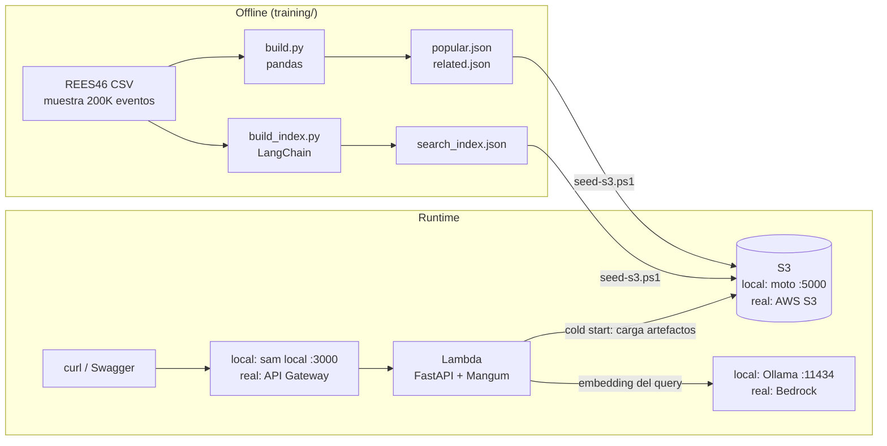

# Plan — Proyecto "RealTime RecSys" (Python + FastAPI + AWS Lambda + S3 + LangChain)

## Objetivo
Armar en **7 días, con 1 hora diaria**, la **base funcional** de un sistema de recomendación en tiempo real para e-commerce. La idea es tener algo que puedas revisar, correr y explicar, y aprender en el camino los fundamentos del stack.

**Todo se desarrolla en local y cuesta $0.** No necesitas cuenta de AWS para los días 1–7: Lambda, S3 y los embeddings se emulan en tu máquina. El **día 8 (opcional)** despliega una sola vez a AWS real para tener una URL viva en el README.

Al terminar la semana el sistema debe:
1. Recibir eventos del usuario (`view`, `cart`, `purchase`).
2. Recomendar productos que **cambian según lo que el usuario hace en la sesión**.
3. Cargar su "modelo" desde **S3** (emulado con moto).
4. Correr como **AWS Lambda** (emulada con `sam local`).
5. Tener una búsqueda en lenguaje natural con **LangChain** (embeddings locales con Ollama).

> **Regla de oro:** cada día tiene un "Listo cuando". Si se acaba la hora, termina ese criterio y para ahí. No adelantes el día siguiente.

### Lo que NO entra en esta semana (va en "Siguientes pasos")
DynamoDB, Item2Vec/FAISS para recomendaciones, métricas NDCG, pruebas de carga y frontend. Primero la base; después la sofisticación.

---

## Stack: local vs AWS real

| Pieza | Desarrollo local ($0) | AWS real (día 8) | Equivalente .NET/Azure |
|---|---|---|---|
| Lenguaje | **Python 3.12** | — | C# |
| Paquetes / entorno | **uv** + `pyproject.toml` | — | `dotnet` CLI + `.csproj` + NuGet |
| API | **FastAPI** + **Pydantic** | — | Minimal APIs + records / DataAnnotations |
| Inyección de dependencias | `Depends()` de FastAPI | — | DI de ASP.NET Core |
| Datos (offline) | **pandas** + Parquet | — | LINQ sobre colecciones |
| Tests | **pytest** + **moto** (mock en memoria) | — | xUnit + mocks |
| Cómputo | `sam local start-api` (Lambda en Docker) | **AWS Lambda** (contenedor) + Mangum | Azure Functions / Core Tools |
| API pública | SAM local en `127.0.0.1:3000` | **API Gateway (HTTP API)** | APIM / Function URL |
| Almacenamiento | **moto server** (S3 falso en `:5000`) | **S3** | Azurite → Blob Storage |
| Embeddings | **Ollama** + `nomic-embed-text` | **Bedrock** Titan Embeddings V2 | Ollama → Azure OpenAI |
| Vector store | `InMemoryVectorStore` de LangChain (JSON) | El mismo | Semantic Kernel memory |
| IaC | **AWS SAM** (`template.yaml`) | El mismo | Bicep / ARM |
| CI | **GitHub Actions** | — | Azure DevOps Pipelines |

> **Por qué moto y no LocalStack:** desde marzo de 2026 LocalStack pide cuenta y auth token (tiene un plan gratis no comercial). Aquí solo necesitamos emular S3, y moto lo hace gratis, sin registro y es la misma librería que ya usas en los tests.

---

## Arquitectura de la base



### Endpoints
| Método | Ruta | Qué hace |
|---|---|---|
| `GET` | `/health` | Health check |
| `POST` | `/events` | Registra un evento en la sesión |
| `GET` | `/recommendations?session_id=...&k=10` | Recomendaciones según la sesión (o populares si está vacía) |
| `POST` | `/search` | Búsqueda en lenguaje natural (LangChain) |

### Estructura final del repo
```
realtime-recsys/
├── app/
│   ├── __init__.py
│   ├── handler.py                # Mangum → Lambda
│   ├── api/
│   │   ├── __init__.py
│   │   ├── main.py               # FastAPI app, endpoints, lifespan
│   │   └── schemas.py            # modelos Pydantic
│   ├── domain/
│   │   ├── __init__.py
│   │   └── recommender.py        # lógica pura, sin AWS
│   └── infrastructure/
│       ├── __init__.py
│       ├── aws.py                # cliente S3 (local o real)
│       ├── artifacts.py          # carga local o desde S3
│       ├── session_store.py      # sesión en memoria
│       ├── embeddings.py         # Ollama o Bedrock
│       └── search.py             # índice semántico
├── training/
│   ├── build.py                  # populares + co-ocurrencia
│   └── build_index.py            # índice semántico con LangChain
├── scripts/
│   ├── local-env.ps1             # variables de entorno para modo local
│   └── seed-s3.ps1               # sube artefactos al S3 local
├── tests/
│   ├── test_recommender.py
│   ├── test_api.py
│   └── test_artifacts_s3.py
├── data/                         # (gitignored) CSV y Parquet
├── artifacts/                    # (gitignored) salida del training
├── .github/workflows/ci.yml
├── Dockerfile
├── .dockerignore
├── .gitignore
├── env.json                      # variables para sam local
├── template.yaml                 # AWS SAM
├── pyproject.toml
├── requirements.txt              # generado con uv export
└── README.md
```

---

## Día 0 — Preparación (una sola vez, ~20 min, sin cuenta de AWS)

- [ ] Instalar:
  - Python 3.12
  - [uv](https://docs.astral.sh/uv/getting-started/installation/) → `powershell -ExecutionPolicy ByPass -c "irm https://astral.sh/uv/install.ps1 | iex"`
  - Docker Desktop
  - [AWS CLI v2](https://docs.aws.amazon.com/cli/latest/userguide/getting-started-install.html) (la usaremos contra el S3 falso)
  - [AWS SAM CLI](https://docs.aws.amazon.com/serverless-application-model/latest/developerguide/install-sam-cli.html)
  - [Ollama](https://ollama.com/download) y luego `ollama pull nomic-embed-text`
- [ ] Permitir scripts locales de PowerShell (una vez): `Set-ExecutionPolicy -Scope CurrentUser RemoteSigned`
- [ ] Descargar de Kaggle el dataset **"eCommerce behavior data from multi category store"** (autor: mkechinov). Solo necesitas el archivo **`2019-Oct.csv`**.
- [ ] Verificar: `uv --version`, `docker --version`, `sam --version`, `aws --version`, `ollama list`.

---

## Día 1 — Python moderno + FastAPI

**Aprendes:** uv, estructura de un proyecto Python, Pydantic, FastAPI básico y Swagger automático.

### Pasos
1. Crear el proyecto:
   ```bash
   uv init realtime-recsys --app --python 3.12
   cd realtime-recsys
   uv add fastapi "uvicorn[standard]" pydantic
   uv add --dev pytest httpx ruff
   ```
2. Borrar el `main.py` que genera uv y crear las carpetas `app/`, `app/api/`, `app/domain/`, `app/infrastructure/`, `tests/` y `scripts/`. Las de `app` llevan cada una un `__init__.py` vacío.
3. Agregar al final de `pyproject.toml`, para que pytest encuentre el paquete `app`:
   ```toml
   [tool.pytest.ini_options]
   pythonpath = ["."]
   ```
4. Crear `.gitignore`:
   ```
   .venv/
   __pycache__/
   data/
   artifacts/
   .aws-sam/
   .pytest_cache/
   .ruff_cache/
   ```
5. `app/api/schemas.py`:
   ```python
   from typing import Literal

   from pydantic import BaseModel

   EventType = Literal["view", "cart", "purchase"]


   class Event(BaseModel):
       session_id: str
       product_id: int
       event_type: EventType


   class Recommendation(BaseModel):
       product_id: int
       score: float
   ```
6. `app/api/main.py` (versión inicial con datos fijos):
   ```python
   from fastapi import FastAPI

   from app.api.schemas import Recommendation

   app = FastAPI(title="RealTime RecSys")


   @app.get("/health")
   def health():
       return {"status": "ok"}


   @app.get("/recommendations", response_model=list[Recommendation])
   def recommendations(session_id: str, k: int = 10):
       return [Recommendation(product_id=1, score=0.9), Recommendation(product_id=2, score=0.5)]
   ```
7. Correr: `uv run uvicorn app.api.main:app --reload` y abrir http://127.0.0.1:8000/docs
8. `git init`, primer commit y repo público en GitHub.

### Listo cuando
- [ ] Swagger (`/docs`) muestra los 2 endpoints y responden.
- [ ] Si mandas `k=abc` (desde el navegador, curl o REST Client; Swagger lo bloquea antes de enviarlo), FastAPI regresa un **422** por sí solo. Esa es la validación de Pydantic.

**Commit sugerido:** `chore: project skeleton with FastAPI`

---

## Día 2 — Datos y el primer recomendador (offline)

**Aprendes:** pandas, Parquet y una recomendación por co-ocurrencia ("quien vio X también vio Y").

### Pasos
1. Dependencias solo de desarrollo (no van a Lambda): `uv add --dev pandas pyarrow`
2. Copiar `2019-Oct.csv` a `data/raw/`.
3. Explorar 5 minutos en un REPL (`uv run python`):
   ```python
   import pandas as pd
   df = pd.read_csv("data/raw/2019-Oct.csv", nrows=1000)
   df.head(); df.dtypes; df["event_type"].value_counts()
   ```
   Columnas: `event_time, event_type, product_id, category_id, category_code, brand, price, user_id, user_session`.
4. `training/build.py`:
   ```python
   """Construye los artefactos del recomendador a partir de una muestra de REES46."""
   import itertools
   import json
   from collections import Counter, defaultdict
   from pathlib import Path

   import pandas as pd

   RAW = Path("data/raw/2019-Oct.csv")
   PROCESSED = Path("data/processed")
   ARTIFACTS = Path("artifacts")
   SAMPLE_ROWS = 200_000
   EVENT_WEIGHTS = {"view": 1, "cart": 3, "purchase": 5}


   def main() -> None:
       PROCESSED.mkdir(parents=True, exist_ok=True)
       ARTIFACTS.mkdir(exist_ok=True)

       # nrows evita cargar los ~5 GB completos
       df = pd.read_csv(RAW, nrows=SAMPLE_ROWS).dropna(subset=["user_session"])
       df.to_parquet(PROCESSED / "events.parquet", index=False)
       (
           df[["product_id", "category_code", "brand", "price"]]
           .drop_duplicates("product_id")
           .to_parquet(PROCESSED / "products.parquet", index=False)
       )

       # 1) Populares: suma ponderada por tipo de evento
       df["weight"] = df["event_type"].map(EVENT_WEIGHTS)
       popular = df.groupby("product_id")["weight"].sum().nlargest(100).index
       (ARTIFACTS / "popular.json").write_text(json.dumps([int(p) for p in popular]))

       # 2) Co-ocurrencia: productos vistos en la misma sesión
       cooc: dict[int, Counter] = defaultdict(Counter)
       sessions = df.groupby("user_session")["product_id"].apply(lambda s: list(dict.fromkeys(s)))
       for items in sessions:
           for a, b in itertools.permutations(items[:30], 2):
               cooc[a][b] += 1
       related = {str(a): [int(b) for b, _ in c.most_common(20)] for a, c in cooc.items()}
       (ARTIFACTS / "related.json").write_text(json.dumps(related))

       print(f"eventos={len(df):,} productos_con_relacionados={len(related):,}")


   if __name__ == "__main__":
       main()
   ```
5. Correr: `uv run python training/build.py`
6. Probar a mano:
   ```bash
   uv run python -c "import json; r=json.load(open('artifacts/related.json')); k=next(iter(r)); print(k, r[k][:10])"
   ```

### Listo cuando
- [ ] Existen `artifacts/popular.json` y `artifacts/related.json`.
- [ ] Puedes tomar un `product_id` y ver sus 10 relacionados.
- [ ] Entiendes qué hace `groupby` y por qué `dict.fromkeys` quita duplicados conservando el orden.

**Commit sugerido:** `feat(training): popularity and co-occurrence artifacts`

---

## Día 3 — Tiempo real: eventos + sesión + DI + tests

**Aprendes:** separar dominio de infraestructura, `lifespan` (startup), `Depends()` y pytest con `TestClient`.

### Pasos
1. `app/domain/recommender.py` (lógica pura, sin I/O):
   ```python
   from collections import Counter

   EVENT_WEIGHTS = {"view": 1.0, "cart": 3.0, "purchase": 5.0}
   RECENCY_DECAY = 0.8  # el evento más reciente pesa más


   class Recommender:
       def __init__(self, related: dict[str, list[int]], popular: list[int]):
           self._related = related
           self._popular = popular

       def recommend(self, history: list[tuple[int, str]], k: int = 10) -> list[tuple[int, float]]:
           seen = {pid for pid, _ in history}
           scores: Counter[int] = Counter()

           for age, (pid, event_type) in enumerate(reversed(history)):
               weight = EVENT_WEIGHTS[event_type] * (RECENCY_DECAY ** age)
               for rank, candidate in enumerate(self._related.get(str(pid), [])):
                   if candidate not in seen:
                       scores[candidate] += weight / (rank + 1)

           result = [(pid, round(score, 4)) for pid, score in scores.most_common(k)]

           # Relleno con populares (y cold start cuando no hay historial)
           for pid in self._popular:
               if len(result) >= k:
                   break
               if pid not in seen and pid not in scores:
                   result.append((pid, 0.0))
           return result
   ```
2. `app/infrastructure/session_store.py`:
   ```python
   from collections import defaultdict, deque


   class InMemorySessionStore:
       """Guarda las últimas N interacciones por sesión. OJO: vive en memoria del proceso."""

       def __init__(self, max_events: int = 20):
           self._sessions: dict[str, deque] = defaultdict(lambda: deque(maxlen=max_events))

       def add(self, session_id: str, product_id: int, event_type: str) -> None:
           self._sessions[session_id].append((product_id, event_type))

       def get(self, session_id: str) -> list[tuple[int, str]]:
           return list(self._sessions.get(session_id, []))
   ```
3. `app/infrastructure/artifacts.py` (por ahora solo local; S3 llega el día 4):
   ```python
   import json
   import os
   from pathlib import Path


   def load_artifacts() -> tuple[dict[str, list[int]], list[int]]:
       base = Path(os.getenv("ARTIFACTS_DIR", "artifacts"))

       def read(name: str):
           return json.loads((base / name).read_text())

       return read("related.json"), read("popular.json")
   ```
4. Reemplazar `app/api/main.py`:
   ```python
   from contextlib import asynccontextmanager
   from typing import Annotated

   from fastapi import Depends, FastAPI, Request

   from app.api.schemas import Event, Recommendation
   from app.domain.recommender import Recommender
   from app.infrastructure.artifacts import load_artifacts
   from app.infrastructure.session_store import InMemorySessionStore


   @asynccontextmanager
   async def lifespan(app: FastAPI):
       # Se ejecuta una vez al arrancar (en Lambda: en cada cold start)
       related, popular = load_artifacts()
       app.state.recommender = Recommender(related, popular)
       app.state.sessions = InMemorySessionStore()
       yield


   app = FastAPI(title="RealTime RecSys", lifespan=lifespan)


   def get_recommender(request: Request) -> Recommender:
       return request.app.state.recommender


   def get_sessions(request: Request) -> InMemorySessionStore:
       return request.app.state.sessions


   RecommenderDep = Annotated[Recommender, Depends(get_recommender)]
   SessionsDep = Annotated[InMemorySessionStore, Depends(get_sessions)]


   @app.get("/health")
   def health():
       return {"status": "ok"}


   @app.post("/events", status_code=202)
   def track_event(event: Event, sessions: SessionsDep):
       sessions.add(event.session_id, event.product_id, event.event_type)
       return {"accepted": True}


   @app.get("/recommendations", response_model=list[Recommendation])
   def recommendations(session_id: str, recommender: RecommenderDep, sessions: SessionsDep, k: int = 10):
       history = sessions.get(session_id)
       return [Recommendation(product_id=p, score=s) for p, s in recommender.recommend(history, k)]
   ```
5. `tests/test_recommender.py`:
   ```python
   from app.domain.recommender import Recommender


   def test_empty_history_returns_popular():
       rec = Recommender(related={}, popular=[9, 8, 7])
       assert [p for p, _ in rec.recommend([], k=2)] == [9, 8]


   def test_cart_weighs_more_than_view():
       rec = Recommender(related={"1": [10], "2": [20]}, popular=[])
       result = rec.recommend([(1, "cart"), (2, "view")], k=2)
       assert result[0][0] == 10


   def test_does_not_recommend_seen_items():
       rec = Recommender(related={"1": [2, 3]}, popular=[])
       result = rec.recommend([(1, "view"), (2, "view")], k=5)
       assert 2 not in [p for p, _ in result]
   ```
   > En `test_cart_weighs_more_than_view`: el producto 2 es el más reciente (decay 1.0, view → 1.0) y el 1 tiene decay 0.8 (cart → 3.0 × 0.8 = 2.4). Gana el cart. Haz la cuenta tú mismo para entender el scoring.
6. `tests/test_api.py`:
   ```python
   import json

   from fastapi.testclient import TestClient


   def test_recommendations_change_after_event(tmp_path, monkeypatch):
       (tmp_path / "related.json").write_text(json.dumps({"1": [2, 3]}))
       (tmp_path / "popular.json").write_text(json.dumps([9, 8]))
       # Aísla el test de las variables del modo local (día 4+)
       monkeypatch.setenv("ARTIFACTS_SOURCE", "local")
       monkeypatch.setenv("ARTIFACTS_DIR", str(tmp_path))
       monkeypatch.delenv("ENABLE_SEARCH", raising=False)

       from app.api.main import app

       with TestClient(app) as client:  # el "with" dispara el lifespan
           before = client.get("/recommendations", params={"session_id": "s1", "k": 2}).json()
           client.post("/events", json={"session_id": "s1", "product_id": 1, "event_type": "view"})
           after = client.get("/recommendations", params={"session_id": "s1", "k": 2}).json()

       assert [r["product_id"] for r in before] == [9, 8]
       assert [r["product_id"] for r in after] == [2, 3]
   ```
7. Correr `uv run pytest -v` y `uv run ruff check .`
8. Probar en Swagger con un `product_id` real de tu `related.json`: manda 2–3 eventos y mira cómo cambian las recomendaciones.

### Listo cuando
- [ ] Los tests pasan.
- [ ] En Swagger ves que las recomendaciones **cambian después de cada evento**. Ese es el "tiempo real".

**Commit sugerido:** `feat(api): session-aware recommendations with events endpoint`

---

## Día 4 — S3 (emulado con moto server)

**Aprendes:** boto3, buckets y prefijos, endpoints configurables (local vs real) y mocks de AWS en tests.

### Pasos
1. Dependencias:
   ```bash
   uv add boto3
   uv add --dev "moto[server]"
   ```
2. `scripts/local-env.ps1`: todas las variables del modo local en un solo lugar.
   ```powershell
   # Uso: . .\scripts\local-env.ps1   (con el punto al inicio, para que aplique a tu terminal)
   $env:AWS_ACCESS_KEY_ID     = "test"     # moto acepta cualquier credencial
   $env:AWS_SECRET_ACCESS_KEY = "test"
   $env:AWS_DEFAULT_REGION    = "us-east-1"
   $env:ARTIFACTS_SOURCE      = "s3"
   $env:ARTIFACTS_BUCKET      = "recsys-local"
   $env:ARTIFACTS_PREFIX      = "models/v1"
   $env:S3_ENDPOINT_URL       = "http://localhost:5000"
   $env:EMBEDDINGS_PROVIDER   = "ollama"
   $env:ENABLE_SEARCH         = "false"   # cambia a "true" en el día 6
   Write-Host "Modo local activo (S3 en $env:S3_ENDPOINT_URL)"
   ```
3. `scripts/seed-s3.ps1`. moto guarda todo **en memoria**: cada vez que lo reinicias, el bucket desaparece y hay que volver a sembrarlo.
   ```powershell
   $ep = "http://localhost:5000"
   aws --endpoint-url $ep s3 mb s3://recsys-local
   aws --endpoint-url $ep s3 cp artifacts/ s3://recsys-local/models/v1/ --recursive
   aws --endpoint-url $ep s3 ls s3://recsys-local/models/v1/ --recursive
   ```
4. `app/infrastructure/aws.py`, el único lugar que decide si S3 es local o real:
   ```python
   import os

   import boto3
   from botocore.config import Config


   def s3_client():
       # Vacío o no definido = AWS real. Con valor = S3 local (moto).
       endpoint = os.getenv("S3_ENDPOINT_URL") or None
       config = Config(s3={"addressing_style": "path"}) if endpoint else None
       return boto3.client("s3", endpoint_url=endpoint, config=config)
   ```
5. Actualizar `app/infrastructure/artifacts.py` para leer de **local o S3**:
   ```python
   import json
   import os
   from pathlib import Path

   from app.infrastructure.aws import s3_client


   def load_artifacts() -> tuple[dict[str, list[int]], list[int]]:
       if os.getenv("ARTIFACTS_SOURCE", "local") == "s3":
           bucket = os.environ["ARTIFACTS_BUCKET"]
           prefix = os.getenv("ARTIFACTS_PREFIX", "models/v1")
           s3 = s3_client()

           def read(name: str):
               obj = s3.get_object(Bucket=bucket, Key=f"{prefix}/{name}")
               return json.loads(obj["Body"].read())
       else:
           base = Path(os.getenv("ARTIFACTS_DIR", "artifacts"))

           def read(name: str):
               return json.loads((base / name).read_text())

       return read("related.json"), read("popular.json")
   ```
6. `tests/test_artifacts_s3.py` (moto en memoria, sin servidor):
   ```python
   import json

   import boto3
   from moto import mock_aws

   from app.infrastructure.artifacts import load_artifacts


   @mock_aws
   def test_load_artifacts_from_s3(monkeypatch):
       monkeypatch.setenv("AWS_DEFAULT_REGION", "us-east-1")
       monkeypatch.setenv("ARTIFACTS_SOURCE", "s3")
       monkeypatch.setenv("ARTIFACTS_BUCKET", "test-bucket")
       monkeypatch.setenv("ARTIFACTS_PREFIX", "models/v1")
       monkeypatch.delenv("S3_ENDPOINT_URL", raising=False)  # que use el mock, no el servidor

       s3 = boto3.client("s3", region_name="us-east-1")
       s3.create_bucket(Bucket="test-bucket")
       s3.put_object(Bucket="test-bucket", Key="models/v1/related.json", Body=json.dumps({"1": [2]}))
       s3.put_object(Bucket="test-bucket", Key="models/v1/popular.json", Body=json.dumps([5]))

       related, popular = load_artifacts()
       assert related == {"1": [2]}
       assert popular == [5]
   ```
7. Probar de punta a punta con **2 terminales**:
   ```powershell
   # Terminal 1: S3 falso
   uv run moto_server -H 0.0.0.0 -p 5000

   # Terminal 2: sembrar y correr la API leyendo de "S3"
   . .\scripts\local-env.ps1
   .\scripts\seed-s3.ps1
   uv run uvicorn app.api.main:app --reload
   ```
   Extra: abre http://localhost:5000/moto-api/ para ver el dashboard de moto con tu bucket.

### Listo cuando
- [ ] `uv run pytest` pasa (el test de S3 no necesita moto server corriendo).
- [ ] Renombras la carpeta `artifacts/` y la API sigue funcionando porque lee del S3 local.

**Commit sugerido:** `feat(infra): load model artifacts from S3 (moto locally)`

---

## Día 5 — Lambda local con SAM

**Aprendes:** Mangum (adaptador ASGI → Lambda), Lambda como imagen de contenedor, SAM, `sam local`, cold starts y por qué la memoria de Lambda no es estado compartido.

### Pasos
1. `uv add mangum`
2. `app/handler.py`:
   ```python
   from mangum import Mangum

   from app.api.main import app

   handler = Mangum(app)  # ejecuta el lifespan en el cold start
   ```
3. Generar `requirements.txt` sin dependencias de desarrollo (repetir cada vez que agregues paquetes):
   ```bash
   uv export --no-dev --no-hashes --no-emit-project --format requirements-txt -o requirements.txt
   ```
4. `Dockerfile`:
   ```dockerfile
   FROM public.ecr.aws/lambda/python:3.12

   COPY requirements.txt .
   RUN pip install -r requirements.txt --no-cache-dir

   COPY app/ ${LAMBDA_TASK_ROOT}/app/

   CMD ["app.handler.handler"]
   ```
5. `.dockerignore`:
   ```
   .venv
   data
   artifacts
   tests
   scripts
   .aws-sam
   .git
   ```
6. `template.yaml` (sirve igual para local y para AWS real):
   ```yaml
   AWSTemplateFormatVersion: "2010-09-09"
   Transform: AWS::Serverless-2016-10-31
   Description: RealTime RecSys - base

   Parameters:
     ArtifactsBucket:
       Type: String
       Default: recsys-local

   Globals:
     Function:
       Timeout: 30
       MemorySize: 1024

   Resources:
     RecSysFunction:
       Type: AWS::Serverless::Function
       Properties:
         PackageType: Image
         Architectures: [x86_64]
         Environment:
           Variables:
             # Valores para AWS real. En local se sobrescriben con env.json.
             # Toda variable que quieras sobrescribir en local DEBE estar declarada aquí.
             ARTIFACTS_SOURCE: s3
             ARTIFACTS_BUCKET: !Ref ArtifactsBucket
             ARTIFACTS_PREFIX: models/v1
             S3_ENDPOINT_URL: ""
             EMBEDDINGS_PROVIDER: bedrock
             OLLAMA_URL: ""
             ENABLE_SEARCH: "false"
         Policies:
           - S3ReadPolicy:
               BucketName: !Ref ArtifactsBucket
           - Statement:
               - Effect: Allow
                 Action: bedrock:InvokeModel
                 Resource: "*"
         Events:
           Api:
             Type: HttpApi
             Properties:
               Path: /{proxy+}
               Method: ANY
       Metadata:
         Dockerfile: Dockerfile
         DockerContext: .
         DockerTag: v1

   Outputs:
     ApiUrl:
       Value: !Sub "https://${ServerlessHttpApi}.execute-api.${AWS::Region}.amazonaws.com/"
   ```
7. `env.json` (variables para `sam local`). Dentro del contenedor, `localhost` es el propio contenedor; para llegar a tu PC se usa `host.docker.internal`:
   ```json
   {
     "RecSysFunction": {
       "ARTIFACTS_BUCKET": "recsys-local",
       "S3_ENDPOINT_URL": "http://host.docker.internal:5000",
       "EMBEDDINGS_PROVIDER": "ollama",
       "OLLAMA_URL": "http://host.docker.internal:11434",
       "ENABLE_SEARCH": "false"
     }
   }
   ```
8. Construir y levantar (con moto server corriendo y sembrado, igual que el día 4):
   ```powershell
   . .\scripts\local-env.ps1     # sam local pasa estas credenciales falsas al contenedor
   sam build
   sam local start-api --env-vars env.json --warm-containers EAGER
   ```
9. Probar contra la "Lambda" en `http://127.0.0.1:3000`. Usa un `product_id` que exista en tu `related.json`:
   ```powershell
   $URL="http://127.0.0.1:3000"
   curl.exe "$URL/health"
   curl.exe -X POST "$URL/events" -H "Content-Type: application/json" -d '{\"session_id\":\"s1\",\"product_id\":1004856,\"event_type\":\"view\"}'
   curl.exe "$URL/recommendations?session_id=s1"
   ```
10. **Experimento clave:** detén `sam local` y vuelve a levantarlo **sin** `--warm-containers EAGER`. Manda un evento y pide recomendaciones: **la sesión se pierde**, porque cada invocación corre en un contenedor nuevo con memoria vacía. En AWS real pasa lo mismo cuando hay varias instancias concurrentes. Por eso en producción la sesión va en **DynamoDB** (o ElastiCache). Anótalo como tu primer ADR.
11. Observa en la terminal de `sam local` el tiempo del primer request (cold start: arranque del contenedor + carga de artefactos) contra los siguientes.

### Listo cuando
- [ ] La API responde desde `sam local` en el puerto 3000, leyendo del S3 local.
- [ ] Viste con tus propios ojos el problema de la sesión en memoria y lo puedes explicar.

**Commit sugerido:** `feat(lambda): run API as Lambda container with SAM local`

---

## Día 6 — LangChain: búsqueda en lenguaje natural (embeddings locales)

**Aprendes:** embeddings, vector stores, `Document` de LangChain, cómo cambiar de proveedor sin tocar el resto del código y por qué el LLM **no** va en el camino crítico de las recomendaciones.

### Pasos
1. Verificar Ollama: `ollama list` debe mostrar `nomic-embed-text`. Si no, corre `ollama pull nomic-embed-text`.
2. Dependencias:
   ```bash
   uv add langchain-core langchain-ollama numpy
   ```
   > Se usa `InMemoryVectorStore` de `langchain-core`: guarda el índice como JSON, no necesita pickle y para unos miles de productos es suficientemente rápido. (`langchain-community`, donde vivía FAISS, está en proceso de retiro.)
3. `app/infrastructure/embeddings.py`, la fábrica de proveedores:
   ```python
   import os

   from langchain_core.embeddings import Embeddings


   def get_embeddings() -> Embeddings:
       provider = os.getenv("EMBEDDINGS_PROVIDER", "ollama")

       if provider == "ollama":
           from langchain_ollama import OllamaEmbeddings

           return OllamaEmbeddings(
               model="nomic-embed-text",
               base_url=os.getenv("OLLAMA_URL") or "http://localhost:11434",
           )
       if provider == "bedrock":  # se usa en el día 8
           from langchain_aws import BedrockEmbeddings

           return BedrockEmbeddings(model_id="amazon.titan-embed-text-v2:0")

       raise ValueError(f"EMBEDDINGS_PROVIDER no soportado: {provider}")
   ```
4. `training/build_index.py`:
   ```python
   """Crea un índice semántico de productos con LangChain."""
   import os

   import pandas as pd
   from langchain_core.documents import Document
   from langchain_core.vectorstores import InMemoryVectorStore

   from app.infrastructure.embeddings import get_embeddings

   MAX_PRODUCTS = 5_000


   def describe(row) -> str:
       category = row.category_code if pd.notna(row.category_code) else "unknown category"
       brand = row.brand if pd.notna(row.brand) else "unknown brand"
       return f"{category.replace('.', ' ')} {brand} price {row.price:.2f} USD"


   def main() -> None:
       products = pd.read_parquet("data/processed/products.parquet").head(MAX_PRODUCTS)
       docs = [
           Document(page_content=describe(r), metadata={"product_id": int(r.product_id)})
           for r in products.itertuples()
       ]
       index = InMemoryVectorStore.from_documents(docs, get_embeddings())
       index.dump("artifacts/search_index.json")
       print(f"indexados={len(docs):,} proveedor={os.getenv('EMBEDDINGS_PROVIDER', 'ollama')}")


   if __name__ == "__main__":
       main()
   ```
   Correr: `uv run python -m training.build_index`. Se usa `-m` para que Python encuentre el paquete `app`. Con Ollama tarda unos minutos; para probar rápido baja `MAX_PRODUCTS` a 500.
5. `app/infrastructure/search.py`:
   ```python
   import os
   from pathlib import Path

   from langchain_core.vectorstores import InMemoryVectorStore

   from app.infrastructure.aws import s3_client
   from app.infrastructure.embeddings import get_embeddings

   INDEX_FILE = "search_index.json"


   def load_search_index() -> InMemoryVectorStore:
       if os.getenv("ARTIFACTS_SOURCE") == "s3":
           path = Path("/tmp") / INDEX_FILE  # /tmp es el único disco escribible en Lambda
           bucket = os.environ["ARTIFACTS_BUCKET"]
           prefix = os.getenv("ARTIFACTS_PREFIX", "models/v1")
           s3_client().download_file(bucket, f"{prefix}/{INDEX_FILE}", str(path))
       else:
           path = Path(os.getenv("ARTIFACTS_DIR", "artifacts")) / INDEX_FILE

       # El índice se debe consultar con el MISMO proveedor de embeddings con el que se creó
       return InMemoryVectorStore.load(str(path), get_embeddings())
   ```
6. Agregar a `app/api/schemas.py`:
   ```python
   class SearchRequest(BaseModel):
       query: str
       k: int = 10


   class SearchResult(BaseModel):
       product_id: int
       description: str
       similarity: float  # coseno: más alto = más parecido
   ```
7. En `app/api/main.py`:
   - Imports: `import os`, `from fastapi import HTTPException`, agregar `SearchRequest, SearchResult` al import de schemas y `from app.infrastructure.search import load_search_index`.
   - En el `lifespan`, antes del `yield`:
     ```python
     app.state.search_index = load_search_index() if os.getenv("ENABLE_SEARCH") == "true" else None
     ```
     Así los tests siguen funcionando sin Ollama.
   - Endpoint:
     ```python
     @app.post("/search", response_model=list[SearchResult])
     def search(req: SearchRequest, request: Request):
         index = request.app.state.search_index
         if index is None:
             raise HTTPException(status_code=503, detail="Search is disabled")
         results = index.similarity_search_with_score(req.query, k=req.k)
         return [
             SearchResult(product_id=doc.metadata["product_id"], description=doc.page_content, similarity=float(score))
             for doc, score in results
         ]
     ```
8. Activar la búsqueda: cambia `ENABLE_SEARCH` a `"true"` en `scripts/local-env.ps1` y en `env.json`.
9. Probar con uvicorn (más rápido para iterar):
   ```powershell
   . .\scripts\local-env.ps1
   .\scripts\seed-s3.ps1            # vuelve a subir artifacts/, ahora con search_index.json
   uv run uvicorn app.api.main:app --reload
   ```
   ```powershell
   curl.exe -X POST "http://127.0.0.1:8000/search" -H "Content-Type: application/json" -d '{\"query\":\"cheap samsung headphones\",\"k\":5}'
   ```
   Las categorías del dataset están en inglés, así que las búsquedas en inglés funcionan mejor.
10. Probar como Lambda: regenera `requirements.txt` (paso 3 del día 5), luego `sam build` y `sam local start-api --env-vars env.json --warm-containers EAGER`, y repite el curl contra el puerto 3000.

### Listo cuando
- [ ] Una búsqueda en lenguaje natural regresa productos razonables con uvicorn y con `sam local`.
- [ ] Puedes explicar por qué la búsqueda usa embeddings y las recomendaciones no usan LLM: latencia y costo por request a escala.

**Commit sugerido:** `feat(search): natural language product search with LangChain`

---

## Día 7 — Cierre: CI, README y revisión

**Aprendes:** GitHub Actions con uv y cómo presentar un proyecto técnico.

### Pasos
1. `.github/workflows/ci.yml`:
   ```yaml
   name: ci
   on: [push, pull_request]

   jobs:
     test:
       runs-on: ubuntu-latest
       steps:
         - uses: actions/checkout@v4
         - uses: astral-sh/setup-uv@v6
         - run: uv sync
         - run: uv run ruff check .
         - run: uv run pytest -v
   ```
   Los tests no necesitan moto server, Ollama ni AWS, así que corren en CI sin configuración extra.
2. `README.md` con estas secciones:
   - **Problema** (3 líneas) y **qué hace el sistema**.
   - **Diagrama** (puedes copiar el mermaid de este plan; GitHub lo renderiza).
   - **Cómo funciona el "tiempo real"**: pesos por evento, decay por recencia y fallback a populares.
   - **Cómo correrlo en local, sin cuenta de AWS**: moto server + `local-env.ps1` + `seed-s3.ps1` + uvicorn o `sam local`.
   - **Decisiones de diseño**: sesión en memoria vs DynamoDB (con el experimento del día 5); LLM fuera del hot path; proveedores de embeddings intercambiables; moto vs LocalStack; Lambda contenedor vs zip.
   - **Lo que aprendí** y **Siguientes pasos**.
3. Repasar el código completo de punta a punta y anotar dudas.

### Listo cuando
- [ ] El badge de CI está en verde.
- [ ] Alguien puede clonar el repo y correrlo en local siguiendo solo el README, sin cuenta de AWS.
- [ ] Puedes explicar en 2 minutos el flujo completo: evento → sesión → candidatos → ranking → respuesta.

**Commit sugerido:** `docs: README, architecture and CI`

---

## Día 8 (opcional) — Despliegue real en AWS

Hazlo **una vez**, cuando todo funcione en local. Una URL viva y una captura en el README pesan en entrevistas. Con este volumen, Lambda, API Gateway, S3 y unos cuantos embeddings deberían costar centavos o nada; aun así, pon la alerta y borra todo al terminar.

### Pasos
1. Cuenta de AWS y **alerta de presupuesto de $5 USD**: Billing → Budgets → *Create budget* → *Monthly cost budget*.
2. Un usuario IAM para desarrollo (o IAM Identity Center) y `aws configure` con región **`us-east-1`**.
3. **Abre una terminal nueva SIN `local-env.ps1`**, para que las credenciales falsas y `S3_ENDPOINT_URL` no apunten a moto. Verifica con `aws sts get-caller-identity`.
4. En la consola de **Amazon Bedrock** → *Model catalog*, verifica que **Titan Text Embeddings V2** (`amazon.titan-embed-text-v2:0`) esté disponible en `us-east-1`. Si te pide habilitar el acceso al modelo, hazlo.
5. Agregar el proveedor y regenerar dependencias:
   ```bash
   uv add langchain-aws
   uv export --no-dev --no-hashes --no-emit-project --format requirements-txt -o requirements.txt
   ```
6. **Reconstruir el índice con Bedrock.** El de Ollama no sirve en la nube porque los vectores de modelos distintos no son compatibles:
   ```powershell
   $env:EMBEDDINGS_PROVIDER="bedrock"; $env:AWS_DEFAULT_REGION="us-east-1"
   uv run python -m training.build_index
   ```
7. Crear el bucket real y subir los artefactos (el nombre debe ser único globalmente):
   ```bash
   aws s3 mb s3://recsys-eduardo-artifacts --region us-east-1
   aws s3 cp artifacts/ s3://recsys-eduardo-artifacts/models/v1/ --recursive
   ```
8. Activar la búsqueda en `template.yaml` (`ENABLE_SEARCH: "true"`) y desplegar:
   ```bash
   sam build
   sam deploy --guided
   ```
   En el asistente: stack name `realtime-recsys`, región `us-east-1`, `ArtifactsBucket` = `recsys-eduardo-artifacts`, acepta crear el repositorio ECR administrado y guarda la configuración en `samconfig.toml`.
9. Probar con la URL del output (los mismos `curl` del día 5 y 6) y ver logs: `sam logs --stack-name realtime-recsys --tail`. En CloudWatch busca `Init Duration` para medir el cold start real.
10. Captura de pantalla o GIF para el README y luego **limpieza**:
    ```bash
    sam delete --stack-name realtime-recsys
    aws s3 rb s3://recsys-eduardo-artifacts --force
    ```
11. Para volver a trabajar en local: `$env:EMBEDDINGS_PROVIDER="ollama"` y vuelve a correr `build_index`.

### Listo cuando
- [ ] Tuviste una URL pública funcionando y la documentaste en el README.
- [ ] Borraste el stack y el bucket, y la factura sigue en ~$0.

---

## Problemas comunes

| Síntoma | Causa probable | Solución |
|---|---|---|
| `ModuleNotFoundError: app` en pytest | Falta `pythonpath` | Agregar `[tool.pytest.ini_options] pythonpath = ["."]` |
| `ModuleNotFoundError: app` en `build_index` | Se corrió como archivo | Usar `uv run python -m training.build_index` |
| `NoSuchBucket` al arrancar la API | Reiniciaste moto (vive en memoria) | Correr `.\scripts\seed-s3.ps1` |
| `Could not connect to the endpoint URL` | moto server no está corriendo | `uv run moto_server -H 0.0.0.0 -p 5000` |
| `sam local` no llega a moto u Ollama | `localhost` dentro del contenedor | Usar `host.docker.internal` en `env.json`; moto con `-H 0.0.0.0` |
| `sam local` no llega a Ollama aunque uses `host.docker.internal` | Ollama escucha solo en 127.0.0.1 | Variable de entorno de Windows `OLLAMA_HOST=0.0.0.0` y reiniciar Ollama |
| Variables de `env.json` no se aplican | No están declaradas en `template.yaml` | Declararlas en `Environment.Variables` |
| `sam build` falla | Docker no está corriendo | Abrir Docker Desktop |
| La sesión se pierde entre requests en `sam local` | Contenedor nuevo por invocación | `--warm-containers EAGER` (y es justo el ADR del día 5) |
| No se pueden ejecutar los `.ps1` | Execution policy | `Set-ExecutionPolicy -Scope CurrentUser RemoteSigned` |
| Tests fallan solo en tu terminal | Quedaron variables del modo local | Los tests usan `monkeypatch`; revisa que aíslen `ARTIFACTS_SOURCE` y `S3_ENDPOINT_URL` |
| Resultados de búsqueda sin sentido | Índice creado con otro proveedor de embeddings | Reconstruir el índice con el proveedor actual |
| Cambié dependencias y la Lambda no las ve | `requirements.txt` desactualizado | Repetir `uv export ...` y `sam build` |
| (Día 8) `AccessDeniedException` en Bedrock | Modelo no habilitado | Habilitarlo en la consola de Bedrock |

---

## Siguientes pasos (después de la base)

1. **DynamoDB** para la sesión, con TTL. Resuelve el problema del día 5. En local se emula con moto o con *DynamoDB Local* (imagen oficial de AWS, gratis).
2. **Evaluación offline**: split temporal y Recall@10 / NDCG@10 contra el baseline de popularidad.
3. **Item2Vec + FAISS** (`faiss-cpu` directo) para generar candidatos con embeddings de comportamiento.
4. **Simulador** que reproduce el stream de eventos de REES46 contra la API.
5. **Prueba de carga** con Locust o k6: p95, RPS y costo estimado por 1M recomendaciones.
6. **Explicaciones con LLM** ("porque viste X…") generadas de forma asíncrona y cacheadas.
7. **CD con GitHub Actions + OIDC** hacia AWS, sin llaves guardadas.

Con eso tendrás los números reales para el pitch final del proyecto.

---

## Checklist general

- [ ] Día 0 — Herramientas instaladas (sin cuenta de AWS)
- [ ] Día 1 — FastAPI corriendo
- [ ] Día 2 — Artefactos de recomendación
- [ ] Día 3 — Recomendaciones en tiempo real + tests
- [ ] Día 4 — Artefactos desde S3 local (moto)
- [ ] Día 5 — Lambda local con `sam local`
- [ ] Día 6 — Búsqueda con LangChain + Ollama
- [ ] Día 7 — CI + README
- [ ] Día 8 (opcional) — Despliegue real en AWS y limpieza
